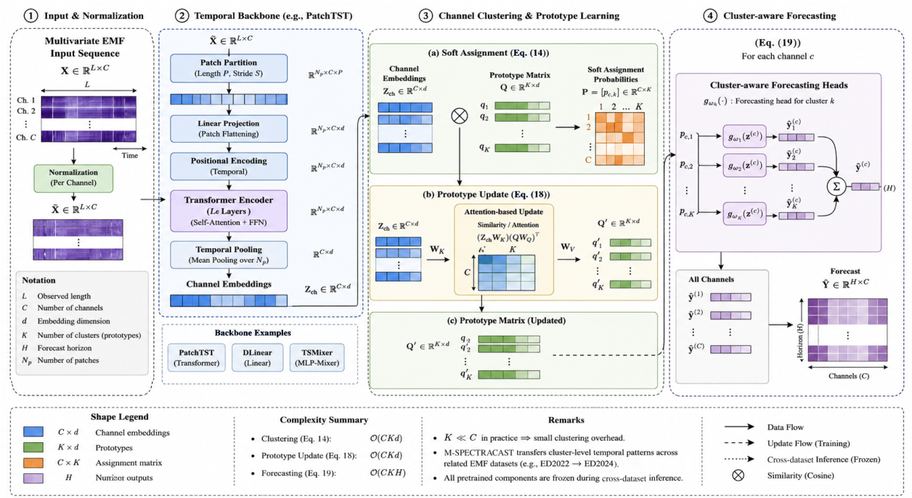

# M-SpectraCast

### Multivariate Cluster-Enhanced Time-Series Forecasting for Wireless Networks

[](https://doi.org/10.1109/OJCOMS.2026.3743620)
[](https://ieeexplore.ieee.org/document/11738776)
[](LICENSE)

**Sadeq Bani Melhem, Hina Tabassum, Luca Chiaraviglio, and Uyen Trang Nguyen**

*IEEE Open Journal of the Communications Society*, vol. 7, pp. 13525-13547, 2026.

[Paper](https://doi.org/10.1109/OJCOMS.2026.3743620) · [Datasets](#datasets) · [Quick start](#quick-start) · [Data quality](docs/DATA_QUALITY.md) · [Citation](#citation)

M-SpectraCast is a clustering-enhanced framework for multivariate wireless time-series forecasting. It learns soft groups of frequency channels with related temporal behavior and combines cluster-specific forecasting heads, enabling selective information sharing across channels. The paper evaluates the approach with **DLinear, PatchTST, and TSMixer** on long-term, frequency-selective radio-frequency electromagnetic field (RF-EMF) measurements from Rome, Italy.



*Fig. 1 from the authors' manuscript, DOI [10.1109/OJCOMS.2026.3743620](https://doi.org/10.1109/OJCOMS.2026.3743620), reproduced under [CC BY 4.0](https://creativecommons.org/licenses/by/4.0/). The drawing is extracted from its page without changes to its content.*

## What is included

- Four original measurement exports, with checksums and a channel dictionary.
- A dependency-free preparation tool that reads the CSV/ZIP files, checks their identity, and creates consistent CSV exports.
- Dataset provenance, observed data-quality findings, and the paper's experimental protocol.
- Machine-readable citation metadata and an attributed framework figure.

**Forecasting training code, trained checkpoints, and the exact cross-dataset channel map are not included in this repository.** The utilities below support dataset access and inspection. They do not reproduce the paper's model results.

## Datasets

ED denotes the Electronics Department of the University of Rome Tor Vergata; UH denotes the University Hospital complex. Each numeric column is a monitored frequency channel in MHz, and its values represent electric-field strength in V/m.

| Dataset | Download | Rows in this export | Channels | Timestamp range in this export |
| --- | --- | ---: | ---: | --- |
| ED-2022 | [ED2022.csv](ED2022.csv) | 34,061 | 27 | 2022-06-24 to 2022-12-07 |
| UH-2022 | [UH2022.csv](UH2022.csv) | 43,529 | 27 | 2022-05-16 to 2022-12-15 |
| ED-2024 | [ED2024.csv](ED2024.csv) | 56,220 | 29 | 2023-03-15 to 2024-07-19 |
| UH-2024 | [UH2024.zip](UH2024.zip), containing `UH2024.csv` | 68,699 | 29 | 2023-03-21 to 2024-08-23 |

These dimensions and dates were checked against the files in this repository. **Some export counts and date ranges differ from Table 2 of the paper.** The original exports are preserved, and the differences are listed in [DATA_QUALITY.md](docs/DATA_QUALITY.md). Campaign names are retained from the paper; `2024` campaigns began in 2023.

[Dataset card](docs/DATASET_CARD.md) · [Channel dictionary](data/channel_dictionary.csv) · [SHA-256 checksums](data/SHA256SUMS) · [Machine-readable manifest](data/dataset_manifest.json)

## Quick start

The data utilities require **Python 3.11 or newer** and use only the standard library.

```bash
git clone https://github.com/Sadeq88/M-SpectraCast.git
cd M-SpectraCast
python tools/prepare_datasets.py --output-dir data/processed
```

This creates `ED2022.csv`, `UH2022.csv`, `ED2024.csv`, `UH2024.csv`, and `preparation_report.json` inside `data/processed/`. You can also prepare one campaign:

```bash
python tools/prepare_datasets.py --dataset ED-2022 --output-dir data/processed
```

The tool verifies source-file hashes, removes only wholly empty unnamed columns, converts timestamp text to ISO 8601, and preserves source observation order and measurement strings. It does not resample, interpolate, standardize, or infer a timezone.

**Timestamp handling matters:** three exports contain a local-clock reversal on a date consistent with the autumn daylight-saving transition. The preparation report records these transitions. Do not sort naive local timestamps to resolve them; confirm the source timezone before assigning UTC times. Acquisition gaps are documented in [DATA_QUALITY.md](docs/DATA_QUALITY.md).

To check a prepared file with strictly increasing timestamps:

```bash
python tools/validate_dataset.py data/processed/ED2022.csv --unit V/m
```

For the three exports with documented local-clock reversals, retain row order and explicitly permit those reversals during schema checking:

```bash
python tools/validate_dataset.py data/processed/ED2024.csv --unit V/m --allow-local-clock-regressions
```

This option reports regressions; it does not establish that timestamps are valid UTC times. See the [data guide](data/README.md) for formats, checksums, and output details.

## Research protocol

The paper reports chronological **60% / 20% / 20%** training, validation, and test subsets; per-channel standardization fitted on training data only; a main lookback of **336 observations**; and horizons of **96, 192, 336, and 720 observations**. The main comparisons use **two latent clusters**, Adam with learning rate `1e-3`, batch size `32`, up to `30` epochs, and early stopping with patience `5`. Main results are averaged over five random seeds.

The paper also evaluates frozen-model cross-dataset forecasting from **ED-2022 to ED-2024**, aligning physically corresponding channels and retaining the source-training normalization statistics. See [REPRODUCIBILITY.md](docs/REPRODUCIBILITY.md) for the reported protocol and the experiment artifacts still needed for full numerical reproduction.

## Citation

Please cite the paper when using these datasets or the associated research:

> S. B. Melhem, H. Tabassum, L. Chiaraviglio, and U. T. Nguyen, "M-SpectraCast: Multivariate Cluster-Enhanced Time-Series Forecasting for Wireless Networks," *IEEE Open Journal of the Communications Society*, vol. 7, pp. 13525-13547, 2026, doi: 10.1109/OJCOMS.2026.3743620.

```bibtex
@article{Melhem2026MSpectraCast,
  author  = {Melhem, Sadeq Bani and Tabassum, Hina and Chiaraviglio, Luca and Nguyen, Uyen Trang},
  title   = {{M-SpectraCast}: Multivariate Cluster-Enhanced Time-Series Forecasting for Wireless Networks},
  journal = {IEEE Open Journal of the Communications Society},
  year    = {2026},
  volume  = {7},
  pages   = {13525--13547},
  doi     = {10.1109/OJCOMS.2026.3743620},
  url     = {https://doi.org/10.1109/OJCOMS.2026.3743620}
}
```

Also available as [CITATION.cff](CITATION.cff) and [references.bib](references.bib).

## Support and contributions

Open a [GitHub issue](https://github.com/Sadeq88/M-SpectraCast/issues) for a dataset problem or reproducibility question. Include the dataset filename and hash, code revision, command, and relevant output. See [CONTRIBUTING.md](CONTRIBUTING.md).

## License

The existing [Apache License 2.0](LICENSE) is preserved. The manuscript and reproduced framework figure carry [CC BY 4.0](https://creativecommons.org/licenses/by/4.0/). See [LICENSING.md](LICENSING.md) for scope and [THIRD_PARTY_NOTICES.md](THIRD_PARTY_NOTICES.md) for attribution.
